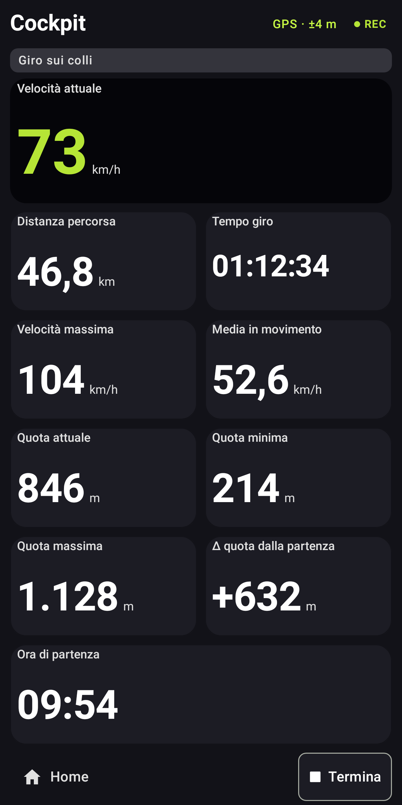
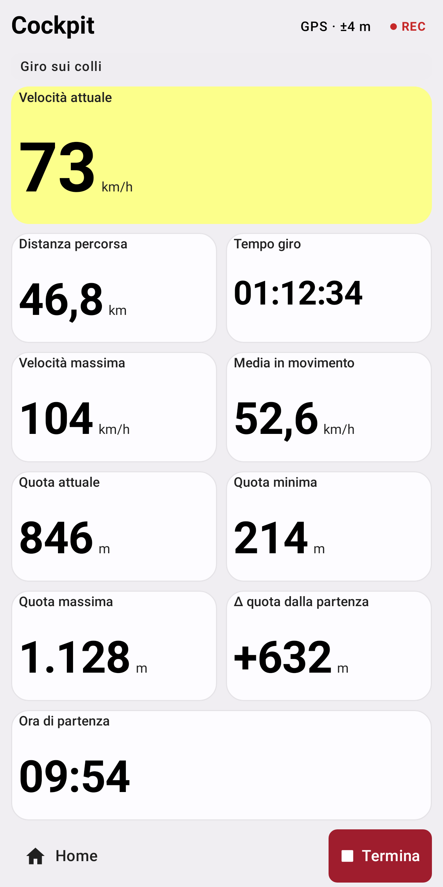

# GPXdev - Navigazione GPX offline

**NO INTERNET - NO ACCOUNT - 100% PRIVACY FOCUS**

**Segui la traccia. Senza Internet!** GPXdev è un'app gratuita per Android per navigare offline seguendo tracce GPX **in moto, in bici e a piedi**. Carica la mappa e il percorso prima di partire. Durante il giro ti basta il segnale GPS per seguire la traccia e registrare il percorso, anche senza copertura Internet o una SIM. Puoi iniziare senza creare un account.

**[Scarica GPXdev per Android ↓](https://gianmaria.dev/download/gpxdev/gpxdev_1.40.0.apk)**

Versione **1.40.0** · APK · Android 10 o successivo


Dati cartografici © [contributori OpenStreetMap](https://www.openstreetmap.org/copyright).

## Come funziona?

- **Segui una traccia GPX.** Importa il file, controlla l'itinerario e avvia la navigazione. Durante il giro vedi la prossima svolta, la distanza rimanente e l'orario di arrivo stimato. Se esci dalla traccia, GPXdev ti avvisa.
- **Esplora la mappa offline.** Guarda dove sei, ingrandisci la zona che ti interessa e scegli se tenere il nord in alto o orientare la mappa nella direzione in cui vai.
- **Parti anche senza un itinerario.** Avvia una registrazione libera e scegli la strada lungo il percorso. Alla fine puoi salvare il giro ed esportarlo come file GPX. Puoi registrare anche mentre segui una traccia già pronta.

Puoi ritrovare le tracce con la ricerca, organizzarle con i preferiti e scegliere tra i temi Soft e Cyber.

### Novità della 1.40.0

- La Home è più compatta. Nell'archivio Soft la ricerca è in primo piano e, se hai già delle tracce salvate, trovi **Importa GPX** nell'intestazione.
- Nel Cockpit verticale vedi prima la velocità, poi distanza e tempo del giro. In orizzontale i dieci dati sono disposti su cinque colonne.
- Nel tema Cyber il fucsia identifica il comando per avviare la registrazione e il lime indica che il giro è in registrazione.

## Prepara tutto. Poi parti.

1. **Installa l'APK.** Apri il file scaricato sul telefono e segui le indicazioni di Android. Se richiesto, abilita **Consenti da questa fonte** per il browser o il gestore file con cui hai aperto l'APK, poi torna all'installazione.
2. **Aggiungi la mappa.** La mappa si scarica a parte. [Scarica la mappa PMTiles dell'Italia da Google Drive](https://drive.google.com/file/d/1cIIloPkRK6lavCgmUsWR27BdaB9i6mbb/view?usp=drive_link), poi apri **Esplora mappa → Scegli mappa PMTiles** e seleziona il file. L'app ne crea una copia nella propria memoria.
3. **Scegli come partire.** Importa un GPX e tocca **Avvia navigazione** per seguire un percorso, oppure scegli **Registrazione libera**. Quando Android te lo chiede, consenti l'accesso alla posizione precisa.

[Visita la pagina di GPXdev su gianmaria.dev](https://gianmaria.dev/progetti/gpxdev.html) per vedere altre schermate e la guida all'installazione.

<details>
<summary>Compila l'app dal sorgente</summary>

Configura JDK 17 e Android SDK con la piattaforma API 36 e i Build Tools 36.0.0. Imposta `JAVA_HOME` e indica il percorso dell'SDK tramite Android Studio o con `sdk.dir` nel file locale `local.properties`. Alla prima compilazione, Gradle scarica le dipendenze.

```powershell
.\gradlew.bat assembleDebug
.\gradlew.bat testDebugUnitTest lintDebug
```

Trovi l'APK di sviluppo in `app/build/outputs/apk/debug/app-debug.apk`.

[Architettura](ARCHITECTURE.md) · [Preparazione delle mappe](offline-maps/README.md) · [Changelog](app/src/main/assets/CHANGELOG.txt) · [Licenza MIT](LICENSE)

</details>

## Schermate in verticale

| Dashboard | Navigazione |
| :---: | :---: |
|  |  |

Le schermate di dashboard e navigazione mostrano la versione 1.35.1.

## Funzione Cockpit

**Registra il giro, ma guarda solo i dati!** Apri **Cockpit** dalla Home, dai un nome al giro e tocca **Avvia Cockpit**. GPXdev registra il percorso con il GPS mentre tu vedi velocità, distanza, tempo e quota in riquadri grandi, senza la mappa sullo schermo.

La velocità massima, la media in movimento e la quota minima e massima ti aiutano a tenere d'occhio l'andamento del giro.

Quando arrivi, tocca **Termina** per vedere il riepilogo. Se vuoi tenere il giro, salvalo nell’archivio e potrai esportarlo come file GPX.

| Cockpit Cyber | Cockpit Soft |
| :---: | :---: |
|  |  |

Mockup della versione 1.37.0 con dati di esempio.
